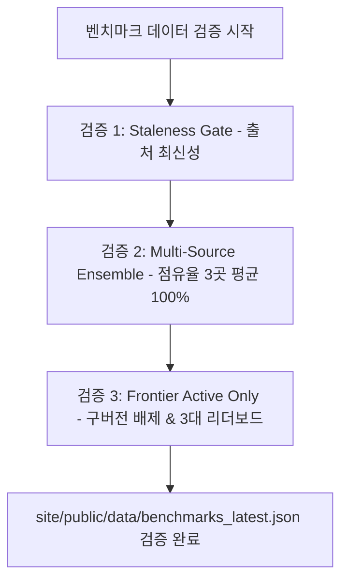

# CC Benchmarks — AI 점유율 및 프론티어 성능 파이프라인

**목적:** 주요 AI 챗봇 서비스의 다중 출처 점유율과 최신 현행(Active Frontier) LLM의 실제 코딩·선호도 벤치마크를 정밀 검증·큐레이션하여 개발자와 엔지니어에게 신뢰할 수 있는 AI 도입 기준을 제공한다.

---

## 1. 3대 핵심 집계 및 검증 원칙



### 1.1 최신성 게이트 (Staleness Gate)
- **점유율 출처 (최대 45일 허용)**: 월간 지표 특성을 고려하여 실행일(Run Date) 기준 45일 이내 데이터만 허용.
- **성능 벤치마크 출처 (최대 30일 허용)**: 일/주 단위 갱신 리더보드 특성을 고려하여 30일 초과 미갱신 시 즉시 배제.
- **과거 링크 엄격 차단**: 2026년 2월 이후 갱신이 멈춘 구형 `swebench.com` 등 방치된 출처는 블랙리스트로 원천 차단.

### 1.2 다중 출처 앙상블 평균 (Multi-Source Ensemble Average)
- **점유율**: 특정 편향을 방지하기 위해 3대 출처의 산술 평균으로 집계하고 합계 100%를 엄격 검증:
  1. `Similarweb`: 웹 방문 트래픽
  2. `Statcounter`: 글로벌 AI 챗봇 리퍼럴(Referral)
  3. `OpenRouter Rankings`: 개발자 API 토큰 소비량
- **성능 지표**: 3대 공신 리더보드 데이터가 모두 존재하는 현행 플래그십 모델만 수록:
  1. `LMArena`: 블라인드 사용자 선호도(Arena Elo) 및 코딩 선호도(Arena Coding Elo)
  2. `Artificial Analysis`: 품질·지능 종합 지수(Quality Index) 및 Throughput
  3. `LiveBench`: 월간 질문 교체 기반 오염 방지 객관식/코딩 벤치마크 점수

### 1.3 구버전(Legacy) 모델 배제 및 대표 모델 원칙
- **현행 최신 모델만 수록**: 이미 단종되거나 세대교체된 구버전 모델(Claude 3.5/3.7, GPT-4o, Llama 2/3, Gemini 1.5/2.5 등)은 블랙리스트로 자동 배제.
- **기업별 대표 모델 1개 원칙**: 특정 벤더의 파생 모델 독식을 막고 주요 AI 연구소(OpenAI, Anthropic, Google, DeepSeek, xAI, Meta 등)의 최고 순위 모델 1개씩 선별.

---

## 2. 실행 명령어 및 검증

```bash
# 벤치마크 데이터 유효성 및 정책 검증 게이트
npm run data:benchmarks
# (동일 명령: node scripts/benchmarks/curate-benchmarks.js)
```

### 필수 체크포인트:
1. `sources`: 최소 6개 이상(점유율 3 + 성능 3) 등록 여부 및 `as_of` 기준일 경과일수
2. `market_shares`: 각 항목의 `share_pct`가 `sources_breakdown` 3곳의 산술 평균과 일치하며 총합 100.0%인지 확인
3. `model_benchmarks`: `arena_elo`, `arena_coding_elo`, `aa_intelligence`, `livebench_score`, 100만 토큰당 가격(`pricing_in_1m`, `pricing_out_1m`), 컨텍스트 길이 누락 없는지 확인

---

## 3. 산출물
- 라이브 서빙 데이터: `site/public/data/benchmarks_latest.json`
- 프론트엔드 라우트: `site/benchmarks.html` (정적 빌드: `dist/benchmarks.html`)
