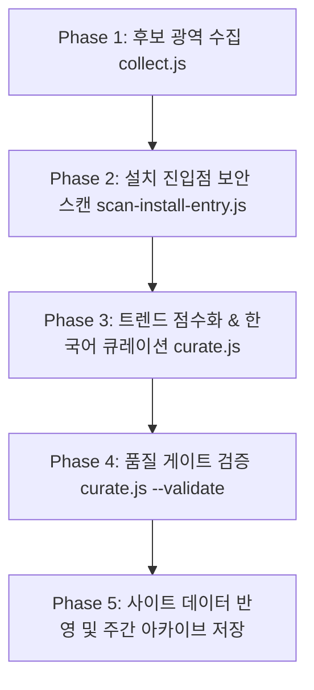

# CC Trends — Claude Code 생태계 트렌드 갱신 파이프라인

**목적:** GitHub 및 개발자 커뮤니티에서 Claude Code 에이전트·하네스·스킬 관련 최신 화제(Rising) 및 필수 레퍼런스(Classic) 저장소를 수집하고, **설치 진입점 보안 스캔**과 **정밀 한국어 큐레이션**을 거쳐 정적 사이트 라이브 데이터를 빌드한다.

---

## 실행 절차 및 세부 단계

### 1. Phase 1: 후보 광역 수집
- **명령어:** `GH_TOKEN=... node scripts/plugins/collect.js`
- **역할:** GitHub Search API와 커뮤니티(HN, Reddit, X, GeekNews 등)를 교차 탐색하여 최근 성장률(Velocity)과 화제성(Buzz)이 높은 후보를 `.tmp/candidates.json`에 수집.
- **원장 기록:** `build-stars-ledger.js`를 통해 수집된 후보의 스타 기록을 원장에 반영.

### 2. Phase 2: 설치 진입점 코드 보안 스캔 (필수 보안 관문)
- **명령어:** `GH_TOKEN=... node scripts/plugins/scan-install-entry.js`
- **목적:** 텍스트 지표나 스타 수 뒤에 숨겨진 악성 드로퍼(C2 하드코딩 IP, 원격 fetch + in-process 동적 exec) 원천 차단.
- **검사 대상:** `package.json`, `setup.py`, `pyproject.toml`, `install.sh` 등 관례적 설치 파일 전수 검사.
- **기준:** 원격 코드 실행(Drop & Exec) 탐지 시 즉시 자동 탈락.

### 3. Phase 3: 트렌드 큐레이션 및 빌드
- **명령어:** `node scripts/plugins/curate.js`
- **정원제 상한 규칙:**
  - **Rising (최대 20건)**: `skill` 8, `mcp` 6, `agent` 4, `harness` 2
  - **Classic (최대 16건)**: `skill` 6, `mcp` 4, `agent` 4, `harness` 2
  - 임계치 미달 시 정원을 억지로 채우지 않음.
- **한국어 메타데이터:**
  - `title_ko`: 한글 타이틀 (원문 직역 지양, 역할 명시)
  - `catchphrase`: 한 줄 훅 (수치는 description 근거만)
  - `summary_ko`: 3~5문장 심층 해설
  - `key_features`: 3대 핵심 기능
  - `use_case`: '이럴 때 사용' 명확한 사용 상황 1문장
  - 신규 저장소는 `scripts/plugins/curated-knowledge-ext.js`에 정밀 사전을 등록하여 제네릭 폴백 차단.

### 4. Phase 4: 품질 게이트 검증
- **명령어:** `node scripts/plugins/curate.js --validate`
- **검증 항목:**
  - `title_ko` 미번역 여부
  - 제네릭 폴백 문구("기능을 프로젝트 개발 환경에 도입하고 싶을 때" 등) 잔존 여부
  - `score`, 카테고리, 상태 정합성

### 5. Phase 5: 사이트 데이터 반영 및 아카이브
- **라이브 데이터:** `site/public/data/latest.json`
- **주간 아카이브:** `data/archive/YYYY-MM-DD.json` 및 `site/public/data/archive/YYYY-MM-DD.json`
- **인덱스 최신화:** `node scripts/core/build-archive-index.js`

---

## 산출물 규격
- 라이브 인덱스: `site/public/data/latest.json`
- 주간 스냅샷: `data/archive/YYYY-MM-DD.json`
- 아카이브 인덱스: `site/public/data/archive/index.json`
