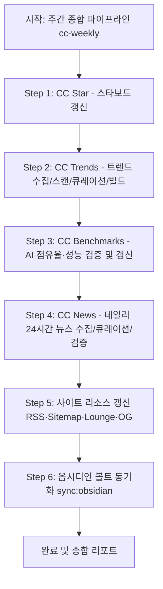

# CC Weekly — 주간 AI Weekly 종합 파이프라인

**목적:** 주간(주말/월요일) 정기 종합 파이프라인으로, AI Weekly의 5대 라이브 서비스 영역인 **스타보드(`cc-star`)**, **Claude Code 트렌드(`cc-trends`)**, **AI 점유율·프론티어 성능(`cc-benchmarks`)**, **데일리 AI 뉴스(`cc-news`)**, 그리고 **AI 라운지 및 사이트 리소스**를 통합 갱신하고 옵시디언 볼트에 전체 이력을 동기화한다.

---

## 실행 순서 및 세부 절차

### 1. Step 1: CC Star (스타보드 갱신)
- **명령어:** `GH_TOKEN=... node scripts/stars/collect-stars.js`
- **역할:** 590+개 주요 오픈소스 리포지토리의 최신 스타 수, 푸시 시점, 설명 메타데이터를 전수 추적하여 랭킹 및 스타 원장을 갱신한다.
- **산출물:** `data/stars/stars_meta.json`, `data/stars/stars_ledger.json` (및 `site/public/data/` 미러링)

### 2. Step 2: CC Trends (Claude Code 트렌드 갱신)
- **절차:**
  1. 광역 수집: `GH_TOKEN=... node scripts/plugins/collect.js` (GitHub + 커뮤니티 후보 탐색 및 원장 기록)
  2. 설치 진입점 보안 스캔: `GH_TOKEN=... node scripts/plugins/scan-install-entry.js` (C2 하드코딩 IP, 원격 Drop & Exec 정적 분석 통과 필수)
  3. 트렌드 큐레이션 및 인덱스 빌드: `node scripts/plugins/curate.js` (Rising 최대 20건, Classic 최대 16건 정원제 선별, 한글 큐레이션)
  4. 품질 게이트 검증: `node scripts/plugins/curate.js --validate` (미번역 및 제네릭 폴백 차단)
  5. 아카이브 인덱스 갱신: `node scripts/core/build-archive-index.js`
- **산출물:** `site/public/data/latest.json`, `data/archive/YYYY-MM-DD.json`, `site/public/data/archive/index.json`

### 3. Step 3: CC Benchmarks (AI 점유율 및 프론티어 성능 갱신) ⭐ [신규]
- **명령어:** `npm run data:benchmarks` (동일: `node scripts/benchmarks/curate-benchmarks.js`)
- **역할:** 주요 AI 챗봇의 3대 출처 점유율과 최신 현행(Active Frontier) 모델 벤치마크를 검증 및 갱신한다.
- **핵심 검문 게이트:**
  1. **최신성 게이트(Staleness Gate)**: 실행일(Run Date) 기준 점유율 출처 45일, 성능 출처 30일 이내 최신 데이터인지 검증. 과거 갱신 중단된 구형 링크(`swebench.com` 등) 원천 차단.
  2. **다중 출처 3곳 앙상블 평균**: 점유율은 Similarweb(웹 방문) + Statcounter(리퍼럴) + OpenRouter(개발자 API) 3곳 산술 평균 및 합계 100.0% 검증.
  3. **3대 리더보드 필수 수록**: LMArena(Elo/Coding), Artificial Analysis(지능 지수), LiveBench(오염방지 점수) 및 100만 토큰당 가격 필수.
  4. **구버전 모델(Legacy Models) 배제**: Claude 3.5, GPT-4o, Llama 2/3 등 구버전 차단 및 기업별 대표 플래그십 1개 원칙 준수.
- **산출물:** `site/public/data/benchmarks_latest.json`

### 4. Step 4: CC News (AI 기술 신호 큐레이션 및 배포)
- **절차:**
  1. 24시간 수집: `GH_TOKEN=... node scripts/news/collect_news.js` (8개 매체 병렬 수집)
  2. 큐레이션: 매체당 3~5건, 신호축당 최대 4건, 총 12~18건 균형 선별.
     - `title_ko`: 자연스러운 한국어 번역 (재등장은 `[업데이트]` 시작)
     - `summary_ko`: 3불릿(`• **키워드**: 설명...` 규격 필수)
     - `body_ko`: 배경, 원리, 한계를 담은 **5~10문장** 엄수
     - 최상위 `summary`: `🔥 오늘의 핵심 이슈: #[키워드1] #[키워드2] #[키워드3] — [기술 흐름 해설]` (단일 문장, 사족 배제)
  3. 품질 게이트 검증: `node scripts/news/curate_news.js --validate` (통과 필수)
- **산출물:** `site/public/data/news_latest.json`, `data/archive/news_YYYY-MM-DD.json`, `data/archive/news_index.json`

### 5. Step 5: 사이트 리소스 갱신
- **RSS 피드 & 사이트맵:** `node scripts/core/generate-rss.js`
- **AI 라운지 Discussions:** `GH_TOKEN=... node scripts/community/collect_lounge.js`
- **오픈그래프(OG) 이미지:** `node scripts/core/generate-og.js`

### 6. Step 6: 옵시디언 볼트 동기화
- **명령어:** `npm run sync:obsidian`
- **역할:** 로컬 옵시디언 볼트(`/Users/nhn/Documents/Obsidian Vault/ai-weekly`)에 주간 종합 작업일지, 아키텍처 명세, 대시보드를 전면 동기화.

---

## 결과 보고 규격
주간 종합 파이프라인 완료 후 아래 5개 항목을 표준 3단 구조(`Executive Summary`, `Detailed Solution`, `Takeaways & Action Items`)에 맞춰 통합 요약 보고합니다:

1. **스타보드 갱신 요약 (`cc-star`)**:
   - 총 추적 대상 리포지토리 수 및 성공률(%)
   - 주요 스타 상승 리포 Top 5 (일평균 증가량 포함)
2. **주간 트렌드 요약 (`cc-trends`)**:
   - 후보 수집 건수 및 설치 진입점 보안 스캔 결과 (C2/악성코드 차단 여부)
   - Rising / Classic 카테고리별(`skill`, `mcp`, `agent`, `harness`) 최종 선정 건수
   - 이번 주 신규 진입 및 순위 급상승 Top 5
3. **AI 점유율 및 프론티어 성능 요약 (`cc-benchmarks`)**:
   - AI 챗봇 점유율 1~3위 (3곳 출처 평균 백분율)
   - 프론티어 코딩/선호도 1~3위 모델 및 종합 점수
   - 6대 출처 최신성 게이트(Staleness Gate) 검과일수 통과 현황
4. **데일리 뉴스 큐레이션 요약 (`cc-news`)**:
   - 24시간 수집 건수 및 최종 큐레이션 건수 (12~18건)
   - 6대 기술 신호축(`model`, `product`, `devtool`, `oss`, `research`, `practice`) 분포
   - 매체별 선별 건수 및 결측(`[MISSING]`) 매체 보고
   - 재등장 중복 차단 건수 및 `[업데이트]` 반영 건수
5. **빌드, 배포 및 옵시디언 동기화 상태**:
   - 전체 검증 게이트 통과 여부 및 정적 빌드(`vite build`) 무결성
   - 옵시디언 볼트 작업일지 생성 및 Git 커밋/푸시 해시
