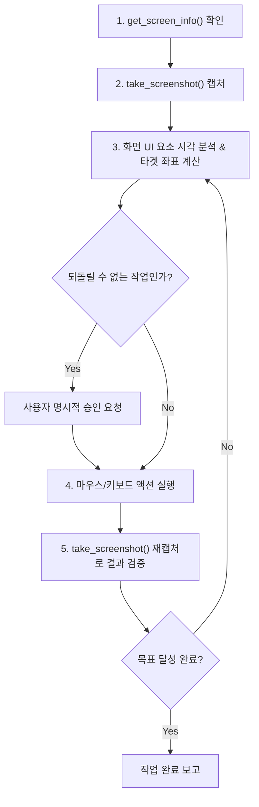

# Windows Computer Use (GUI Agent) Skill

Windows 10/11 로컬 데스크톱 환경에서 화면을 실시간 캡처하고, 마우스 이동·클릭·드래그·스크롤 및 키보드 입력을 정밀 제어하는 네이티브 Computer Use 가이드입니다.

> [!CAUTION]
> **절대 준수 안전 규칙 (Safety Invariants)**
> 1. **비상 정지 (Fail-Safe)**: 에이전트 오작동 시 마우스 커서를 모니터 네 모서리(0, 0 등)로 강제로 이동하면 `pyautogui.FailSafeException`이 발생하여 즉시 모든 작업이 강제 중단됩니다.
> 2. **폭주 방지 딜레이**: 모든 마우스/키보드 액션 사이에는 최소 0.5초 이상의 딜레이(`pyautogui.PAUSE = 0.5`)가 강제 적용됩니다.
> 3. **되돌릴 수 없는 작업 차단 (Human-in-the-Loop)**: 결제, 파일 영구 삭제, 외부 전송/발송, 시스템/네트워크 설정 변경 등 위험하거나 되돌릴 수 없는(Non-idempotent) 클릭이나 타이핑 직전에는 **반드시 사용자에게 명시적으로 확인을 구하고 승인 후에만 실행**해야 합니다.

---

## 1. 아키텍처 및 MCP 도구 세트

`computer-use` MCP 서버는 `mss` 고속 캡처 + `PyAutoGUI` + Windows Win32 API (`WinSta0\Default` 데스크톱 부착 및 Per-Monitor DPI Awareness)를 결합하여 구동됩니다.

### 사용 가능한 MCP 도구 목록
| 도구명 | 설명 | 주요 인자 |
|---|---|---|
| `get_screen_info` | 디스플레이 해상도, 멀티 모니터 목록, DPI 배율, 현재 마우스 위치 반환 | 없음 |
| `take_screenshot` | 지정 모니터 고속 캡처 (Base64 PNG 이미지 반환) | `monitor_index` (기본 1: 주 모니터, 2: 보조, 0: 전체), `max_dimension` |
| `mouse_move` | 마우스 커서 부드러운 이동 (픽셀 또는 0~1000 정규화 좌표) | `x`, `y`, `normalized`, `monitor_index`, `duration` |
| `mouse_click` | 마우스 클릭 (좌/우/더블/트리플 클릭) | `x`, `y`, `button`, `clicks`, `normalized`, `monitor_index` |
| `mouse_drag` | 드래그 앤 드롭 | `start_x`, `start_y`, `end_x`, `end_y`, `duration` |
| `mouse_scroll` | 마우스 휠 스크롤 | `clicks` (양수: 위로, 음수: 아래로), `x`, `y` |
| `keyboard_type` | 텍스트 입력 (한글/유니코드는 클립보드 붙여넣기로 깨짐 방지) | `text` |
| `keyboard_press` | 단일 키 또는 핫키 조합 실행 | `keys` (예: `enter`, `esc`, `ctrl+c`, `win+r`) |
| `execute_computer_action` | Gemini / Claude 표준 액션 통합 인터페이스 | `action`, `coordinate`, `text`, `key` 등 |

---

## 2. 작업 워크플로우 (Loop-by-Step)

GUI 제어는 항상 **[관찰 -> 판단 -> 행동 -> 검증]** 루프로 수행합니다:

### 1단계: 화면 및 모니터 구조 파악
- `get_screen_info()`를 호출하여 사용자의 모니터 구성(예: 듀얼 모니터, 주 모니터 2560x1440, DPI 100%)을 확인합니다.

### 2단계: 화면 캡처 및 타겟 좌표 인식
- `take_screenshot(monitor_index=1)`로 타겟 창이 있는 모니터의 스크린샷을 가져옵니다.
- 이미지 내 버튼, 텍스트 필드, 아이콘의 물리적 좌표(또는 0~1000 정규화 좌표)를 산출합니다.

### 3단계: 안전 가드레일 확인
- 대상 버튼이 결제, 삭제, 발송, 권한 부여 등인지 확인합니다.
- 위험 작업인 경우 클릭을 중단하고 사용자에게 먼저 물어봅니다.

### 4단계: 동작 실행 및 한글 입력
- 클릭: `mouse_click(x=target_x, y=target_y)`
- 텍스트 입력: `keyboard_type(text="입력할 내용")` (한글이 포함되어도 서버 내부에서 클립보드 페이스트로 자동 처리되어 한글 조합이 깨지지 않습니다).
- 단축키: `keyboard_press(keys="ctrl+s")`, `keyboard_press(keys="enter")`

### 5단계: 결과 검증
- 동작 후 즉시 `take_screenshot()`을 다시 호출하여 다이얼로그가 열렸는지, 입력이 정상 반영되었는지 육안 검증합니다.

---

## 3. 좌표 체계 가이드

1. **절대 픽셀 좌표 (`normalized=False`)**:
   - `x`, `y`에 모니터 해상도 기준 픽셀 값을 직접 입력 (예: `x=1280, y=720`).
2. **정규화 좌표 (`normalized=True`)**:
   - `0 ~ 1000` 범위 비율 좌표 (Gemini/Claude Computer Use 표준).
   - `monitor_index=1`일 때 `x=500, y=500`은 주 모니터의 정확한 중앙에 매핑됩니다.
   - `monitor_index=2`일 때 `x=500, y=500`은 보조 모니터의 정확한 중앙에 매핑됩니다.

---

## 4. 예외 및 오작동 대응

- `FailSafeException`: 사용자가 마우스를 화면 모서리로 밀었거나 강제 정지한 경우 발생합니다. 발생 시 즉시 추가 입력을 중단하고 사용자에게 상황을 보고하십시오.
- `Window Not Focused`: 클릭 전 대상 창이 비활성 상태일 수 있으므로 창의 타이틀바나 빈 영역을 먼저 1회 클릭하여 포커스를 획득한 후 입력을 진행하십시오.
