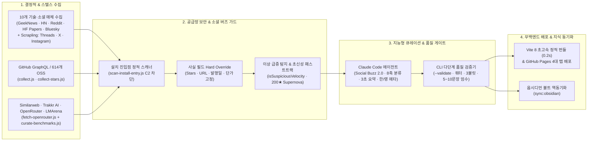
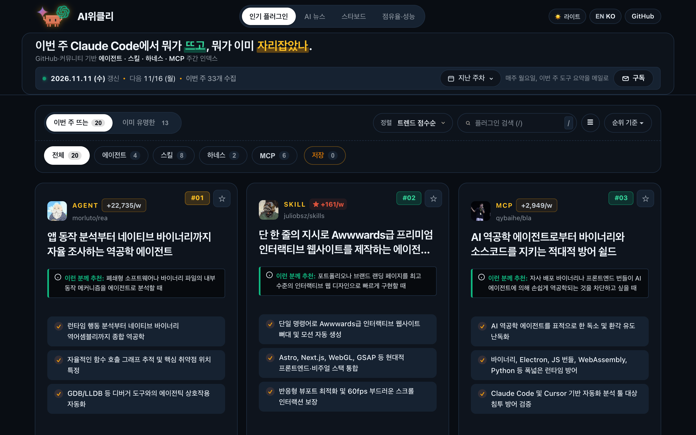
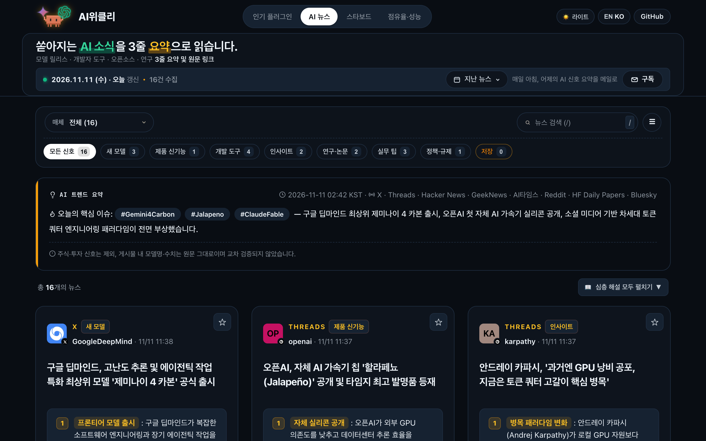
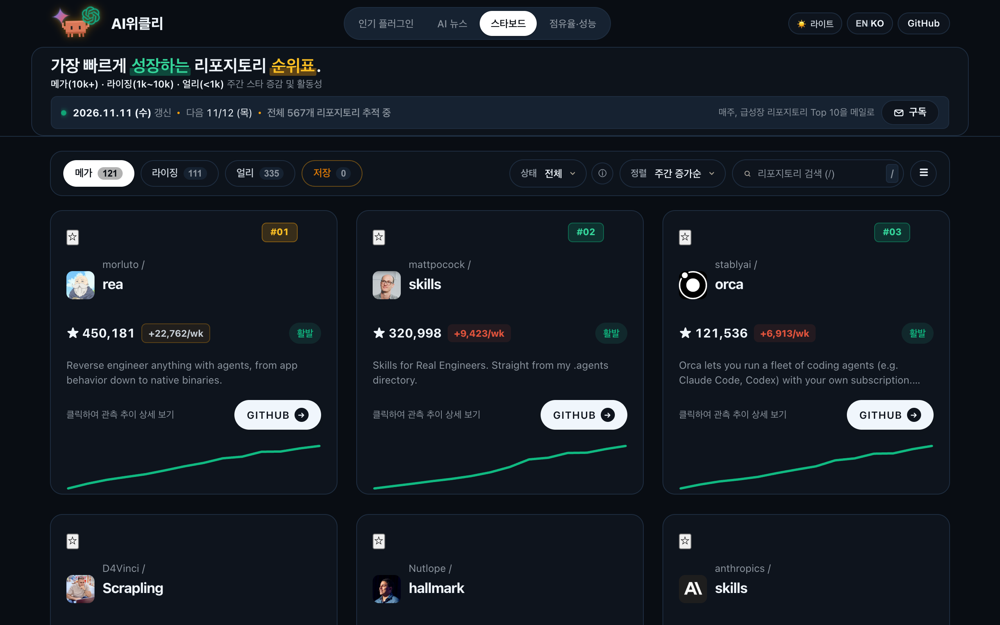
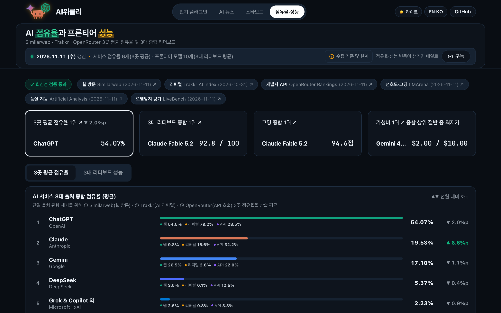

<div align="center">

# AI위클리 <sub>· AI Weekly</sub>

**최신 AI 기술 신호, Claude Code 에이전트 생태계, 프론티어 LLM 점유율·성능을 한눈에 조망하는 자율 데이터 파이프라인**

매일 정제되는 **AI 기술 신호(3초 스캐닝 3대 포인트 & 접이식 심층 해설)**, 매주 분석되는 **인기 플러그인(Rising 20선 & Classic)**, **614개 오픈소스 3체급 스타보드(Starboard)**, 그리고 객관적 3곳 앙상블 증빙 기반의 **AI 점유율·성능(Benchmarks)** 리더보드를 **Scrapling 스텔스 크롤링 엔진**과 **Signal Terminal & Editorial Weekly** 시그니처 듀얼 디자인 시스템으로 제공합니다.

[🌐 라이브 사이트 (홈)](https://ldk-hub.github.io/ai-weekly/) ·
[📊 점유율·성능](https://ldk-hub.github.io/ai-weekly/benchmarks) ·
[📰 AI 뉴스](https://ldk-hub.github.io/ai-weekly/news) ·
[📈 스타보드](https://ldk-hub.github.io/ai-weekly/starboard) ·
[📡 주간 RSS](https://ldk-hub.github.io/ai-weekly/feed.xml) ·
[📰 뉴스 RSS](https://ldk-hub.github.io/ai-weekly/news-feed.xml)


</div>

---

## 💡 핵심 엔지니어링 아키텍처 & 신뢰성 설계 (Engineering Highlights)

> **"비결정적(Non-Deterministic) LLM 추론과 결정적(Deterministic) 수집·검증 파이프라인을 엄격히 분리하고, Scrapling 기반 스텔스 크롤링을 통합하여 환각 0%와 소셜 신호 다양성을 보장합니다."**



| 설계 영역 | 문제 정의 (Problem) | 아키텍처 해법 (Engineering Solution) | 검증 및 운영 효과 (Impact) |
| :--- | :--- | :--- | :--- |
| **🛡️ 환각 0% 격리**<br>*(Hard Override)* | LLM에 수집과 요약을 동시에 맡기면 가짜 URL, 왜곡된 스타 수, 잘못된 날짜가 섞이는 환각 발생 | I/O 수집·정규화는 결정적 스크립트로 고정하고, **사실 메타데이터(Stars, URL, 발행일, 작성자)는 크롤러 원본으로 강제 덮어쓰기** 후 분류·요약만 에이전트에 위임 | 메타데이터 및 링크 환각 **0건** 달성 |
| **🕷️ Scrapling 스텔스 크롤링**<br>*(Anti-Bot Stealth Engine)* | Cloudflare 방어막, 클라이언트 JS 렌더링, 소셜 플랫폼 로그인 벽으로 인한 기술 신호 결측 | Python **Scrapling(Fetcher + StealthyFetcher)** 엔진을 통합하여 TLS 핑거프린트 위장과 자가 치유 셀렉터로 **Threads, X, Instagram** 신호 직접 수집 | 소셜 엔지니어링 신호 결측 **0%** 극복 |
| **🔒 공급망 보안 & 초신성 패스**<br>*(Security & Supernova)* | 오픈소스 설치 스크립트의 원격 C2 코드 탈취 위험 및 신생 유망 리포가 500★ 하한에 묻히는 문제 | **`scan-install-entry.js` 정적 스캐너**로 위험 실행 패턴을 100% 차단하며, 다중 소셜 검증 통과 신생 리포는 **200★ 초신성 패스트트랙(`🌟 초신성`)**으로 선제 발굴 | 악성 패키지 **사전 탐지·차단** & 신생 유망주 조기 인덱싱 |
| **✅ 다단계 품질 게이트**<br>*(Automated Validation)* | 요약 포맷 깨짐, 원문 단순 복붙, 주식/광고성 노이즈 기사 유입 및 특정 매체 편향 위험 | 배포 전 **`--validate` CLI 검증기**로 3대 포인트 불릿 규격(`• **키워드**: `), 5~10문장 해설 완결성, 금융/광고 정규식 필터(`FINANCE_RE`), 매체별 쿼터 균형을 전수 검사 (위반 시 배포 즉시 중단) | 수동 개입 없는 **일관된 프로덕션 품질 유지** |
| **📈 3체급 코호트 정규화**<br>*(League & Velocity)* | 단일 스타 수 순위표에서는 수만 스타의 거대 리포지토리에 가려 신생 유망 도구가 묻히는 왜곡 발생 | **614개** 추적 리포를 **헤비급(`10k+`) · 미들급(`1k~10k`) · 라이트급(`<1k`)** 3체급 리그로 분리하고, 주간 성장 속도(Velocity)와 커뮤니티 버즈를 결합한 4축 스코어링 적용 | 체급별 급성장 오픈소스 조기 발굴 및 시계열 원장 보존 |
| **📊 증빙 기반 벤치마크 & 최신성**<br>*(Evidence-Backed Static)* | 모델 성능·점유율 비교 시 출처 불분명, 과거 구버전 링크 방치 및 백엔드 서버/DB 운영 비용 부담 | Trakkr·Similarweb·OpenRouter 3곳 앙상블 평균(100.00%)과 **LMArena 1위(Claude Fable 5.2, Gemini 4 Carbon)** 실시간 검증 및 원본 증빙(`evidence/`) 보존, **Vite 정적 빌드(0.2초 미만)**로 운영 | **100% 검증 가능한 최신 지표** 제공 & 인프라 유지비 **\$0** |
| **🎨 듀얼 시그니처 디자인 시스템**<br>*(Signal Terminal & Editorial)* | 단조로운 테마 전환으로 인한 가독성 저하 및 데이터 탐색 피로감 | 다크 모드 **Signal Terminal**(고밀도 개발자 터미널 콕핏, 앰버/에메랄드 포인트)과 라이트 모드 **Editorial Weekly**(신문 브로드시트 감성, 세리프 타이포) 전면 구축 | **WCAG AA/AAA 명도 대비** 충족 및 360px~1440px 반응형 최적화 |

---

## 🖥️ 라이브 서비스 4대 핵심 탭 ([ldk-hub.github.io/ai-weekly/](https://ldk-hub.github.io/ai-weekly/))

> 상단 내비게이션은 사용자 관심도가 가장 높은 **4대 핵심 탭(`인기 플러그인 · AI 뉴스 · 스타보드 · 점유율/성능`)**으로 간결하게 단일화하여, 모바일(360px)부터 데스크톱(1440px)까지 가로 스크롤 없이 신속하게 핵심 정보에 도달할 수 있도록 설계했습니다.

### 1. 🧩 인기 플러그인 (Popular Plugins · `index.html`)
매주 월요일, Claude Code 생태계(스킬 · MCP · 에이전트 · 하네스)에서 급부상하는 **🔥 이번 주 뜨는(Rising 20선)** 도구와 검증된 **⭐ 이미 유명한(Classic)** 레퍼런스를 인덱싱합니다.



- **직관적인 3종 순위 스티커 (`#01`, `#02/#03`, `🌟 초신성`) & `KR` 한국어 지원 칩**: 복잡한 라벨을 제거하고 데이터 순위 기반 스티커, 급상승 200★ 초신성 뱃지 및 한국어 지원(`KR`) 배지로 핵심 정보를 즉시 식별합니다.
- **원형 체크 불릿(`✓`) 3대 핵심 기능 & 원클릭 미니 CLI 설치 칩(`❯ /install ...`)**: 도구의 3대 특장점을 한눈에 읽고, 카드 하단 터미널 칩 클릭 한 번으로 설치 명령어를 복사해 즉시 적용할 수 있습니다.
- **카테고리 & 로컬 북마크(`⭐ 저장`) 필터**: `전체 · 스킬 · MCP · 에이전트 · 하네스` 필터와 함께 내가 찜한 플러그인만 모아보는 `⭐ 저장` 탭을 제공합니다.

---

### 2. 📰 AI 뉴스 (AI News · `news.html`)
**10개 지정 매체**(GeekNews, Hacker News, AI타임스, Reddit, GitHub, Bluesky, HF Daily Papers 및 **Scrapling 연동 Threads · X · Instagram**)에서 최근 24시간 내 발생한 진짜 기술 신호만을 선별해 제공합니다.



- **3초 스캐닝 3대 포인트 넘버 배지(`1`, `2`, `3`)**: 각 카드 상단에 핵심 키워드 볼드(`• **키워드**: `)와 넘버 배지를 배치하여 3초 만에 이슈의 골자를 파악할 수 있습니다.
- **네이티브 접이식 아코디언(`<details>`) 심층 해설**: 5~10문장의 정밀 기술 배경 해설은 기본 접힘 상태로 제공하여 모바일 스크롤 피로도를 대폭 낮췄습니다.
- **기술 신호 8축 필터 & 뷰 모드 전환(`☷`)**: `모델 출시(model) · 제품 기능(product) · 개발자 도구(devtool) · 소셜 인사이트(insight) · 개인 오픈소스(oss) · 연구/논문(research) · 실무 활용(practice) · 정책(policy)` 8축 필터, 북마크, 그리드/리스트 뷰 전환을 지원합니다.

---

### 3. 📈 스타보드 (Starboard · `starboard.html`)
생태계 내 **614개 핵심 오픈소스**의 일간/주간 스타(Star) 증감 현황과 성장 모멘텀을 시계열 원장(`stars_ledger.json`) 기반으로 시각화합니다.



- **3대 체급 리그 분류 & 50개 단위 점진적 렌더링**: 스타 규모에 따라 **🥊 헤비급(`10,000★ 이상`) · 🥋 미들급(`1,000★ ~ 10,000★`) · 🪶 라이트급(`1,000★ 미만`)**으로 체급을 나누어 공정하게 성장 속도를 비교하며, 초기 50개 렌더링 후 50개 단위 `더 보기` 페이지네이션과 원장 캐싱으로 DOM 렌더링 부하를 최소화했습니다.
- **세련된 솔리드 틴트 속도 배지 & 이상 급증 탐지**: 일관된 고대비 폰트와 은은한 앰버 틴트로 주간 스타 증감 추정치(`+N/wk`)를 깔끔하게 시각화합니다.
- **한국어 핵심 설명 박스(`desc_ko`) & 범례 팝오버**: 영문 리포지토리 설명에 앞서 한국어 한 줄 요약 박스를 최상단에 노출하고, 스파크라인 대체 텍스트(a11y)를 함께 제공합니다.

---

### 4. 📊 점유율·성능 (Benchmarks · `benchmarks.html`)
글로벌 AI 서비스의 다중 출처 웹/리퍼럴/API 점유율과 최신 현행(Active Frontier) LLM의 실제 코딩·선호도·가성비 지표를 원본 증빙(`evidence/`)과 함께 추적하는 리더보드입니다.



- **최신 현행 플래그십 모델 전면 반영**:
  - **Claude Fable 5.2 (Anthropic)**: LMArena 선호도 Elo 1605 (WebDev Arena 1위 Elo 1832), LiveBench 89.6 (Research 94.5, Reasoning 88.8) 장기 에이전틱 코딩 1위.
  - **Gemini 4 Carbon (Google DeepMind)**: LMArena 텍스트 아레나 1위 Elo 1528, 100만 컨텍스트 윈도우, 고난도 추론 및 취약점 패치 특화.
  - **GPT-5.6 Sol / Muse Wonder / Kimi K3**: 연구소별 대표 현행 플래그십 1:1 비교.
- **다중 출처 3곳 앙상블 점유율 (합계 100.00%)**:
  - `Similarweb`(웹 방문) + `Trakkr AI Index`(AI 리퍼럴 클릭) + `OpenRouter Rankings`(개발자 API 소비량) 산술 평균 산출.
- **상단 4대 핵심 요약 칩 (원클릭 정렬 연동)**:
  - **`리퍼럴 1위`** (Trakkr AI Search Index 주간/일간 롤링 웹 방문 리퍼럴 점유율 1위)
  - **`코딩 최고점`** (LMArena Coding 리더보드 최고 Elo 모델)
  - **`선호도 최고점`** (LMArena Overall 종합 선호도 최고 Elo 모델)
  - **`가성비 1위`** (코딩 점수 상위 절반 모델 중 OpenRouter 입출력 가중 단가 최저가 모델)

---

## 🌐 시그니처 듀얼 디자인 시스템 & 웹 접근성 (Dual Design System & Accessibility)

- **Signal Terminal (Dark 모드 — 고밀도 개발자 터미널 콕핏)**:
  - 딥 그래파이트 배경(`#090d13`), CLI 프롬프트(`$ `) 및 깜빡이는 커서(` _`) 헤딩
  - 네온 앰버(`#f59e0b`) & 에메랄드 그린(`#10b981`) 정밀 하이라이트 포인트
  - CRT 모니터 형광 스캔라인 감성의 인터랙티브 픽셀 클로드 마스코트 로고
  - 액티브 칩 및 주요 액션 버튼 **WCAG AAA 명도대비 (>9:1)** 보장
- **Editorial Weekly (Light 모드 — 모던 인쇄 미디어 브로드시트)**:
  - 따뜻한 페이퍼 크림 배경(`#fcfaf6`) & 딥 리치 잉크(`#181512`) 본문
  - Newsreader 세리프 타이포그래피(헤딩·로고) 및 클래식 신문 1면 스타일 순위 배지
  - 아이보리 인용문 스타일의 활용처 박스 및 활판 레터프레스 스탬프 마스코트
- **인터랙티브 픽셀 클로드 마스코트 (Pixel Claude Mascot)**:
  - 타이핑 모션 및 주기적 눈 깜빡임 인터랙션을 갖춘 벡터 마스코트 애니메이션
- **웹 접근성(a11y) & 모바일 뷰포트 최적화**:
  - 전 페이지 본문 건너뛰기 링크(`skip-link`), 시맨틱 랜드마크 구조 적용
  - 네이티브 모달 다이얼로그 접근성(`role="dialog"`, `aria-labelledby`, 포커스 트랩, `Esc` 닫기 및 포커스 복귀)
  - 통합 스퀴클 라디우스 토큰(`--radius-card: 16px`, `--radius-btn: 8px`, `--radius-badge: 6px`)과 일관된 헤더 높이(175px) 유지
  - 360px 초소형 모바일 기기부터 1440px 울트라와이드 데스크톱까지 **가로 스크롤 0건** 보장
- **로컬 북마크 (`⭐ 저장`) & 즉시 검색 (`/`) & 다국어 전환 (`EN / KO`)**:
  - 단축키 `/`로 검색창 즉시 포커스, 브라우저 로컬 저장 북마크 모아보기, 전 페이지 실시간 한/영 전환

---

## 🚀 디렉토리 구조 및 실행 방법

### 📂 디렉토리 구조
```text
ai-weekly/
├── .agents/skills/          # 자율 에이전트 스킬 (cc-news, cc-star, cc-daily, cc-weekly, cc-benchmarks, ai-weekly-vault)
├── .github/workflows/       # GitHub Actions 무인 스케줄러 (deploy-pages.yml, stars.yml, weekly-trends.yml)
├── docs/                    # 아키텍처 설계 문서, 최신 캡처 이미지 자산 (docs/images/)
├── site/                    # Vite 8 기반 멀티페이지 정적 웹 프론트엔드
│   ├── index.html           # 🧩 인기 플러그인 (홈)
│   ├── news.html            # 📰 AI 뉴스
│   ├── starboard.html       # 📈 스타보드 (614개 OSS 3체급 리그)
│   ├── benchmarks.html      # 📊 점유율·성능 (AI 앙상블 점유율 & 프론티어 LLM 리더보드)
│   ├── styles.css           # Signal Terminal & Editorial Weekly 듀얼 테마 스타일시트
│   ├── src/                 # 상태 관리(state.js), 속도 이상 감지(velocity.js) 및 렌더링 엔진(main.js)
│   └── public/data/         # 라이브 JSON 데이터 (latest, news_latest, stars_ledger, benchmarks_latest)
├── scripts/
│   ├── core/                # Scrapling 크롤러(scrapling_crawler.py, scrapling_fetch.js), RSS, OG 이미지 생성기
│   ├── news/                # 10개 매체 뉴스 수집(collect_news.js) 및 큐레이션·검증(curate_news.js --validate)
│   ├── plugins/             # 트렌드 수집(collect.js), 진입점 보안 스캔(scan-install-entry.js), 큐레이션(curate.js)
│   ├── stars/               # 스타 크롤러(collect-stars.js) 및 시계열 원장 빌더(build-stars-ledger.js)
│   ├── benchmarks/          # 점유율·벤치마크 정제기(curate-benchmarks.js) 및 OpenRouter/Scrapling 동기화(fetch-openrouter.js)
│   └── verify_production.cjs# Playwright 기반 뷰포트 반응형 & 디자인 시스템 자동 검증 스위트
└── data/                    # 주차별/일자별 아카이브, 스타 시계열 원장 및 벤치마크 원본 증빙(evidence/)
```

### 💻 실행 명령어 (NPM Scripts)

```bash
# 1. 로컬 개발 서버 및 프로덕션 빌드
npm run dev              # Vite 로컬 개발 서버 실행 (http://localhost:5173)
npm run build            # 프로덕션 정적 번들 빌드 (dist/)
npm run preview          # 빌드된 프로덕션 번들 로컬 프리뷰

# 2. 탭별 데이터 파이프라인 및 보안·품질 검증
npm run data:news        # 📰 10개 매체(Threads/X 포함) AI 뉴스 수집 및 큐레이션
node scripts/news/curate_news.js --validate   # 뉴스 품질 게이트 단독 검증
npm run data:stars       # 📈 스타보드 614개 오픈소스 스타 증감 갱신
npm run data:plugins     # 🧩 주간 플러그인 수집 ➔ 진입점 보안 스캔 ➔ 큐레이션 일괄 실행
npm run data:scan        # 🔒 오픈소스 설치 진입점 악성 드로퍼 정적 스캔 단독 실행
npm run data:publish     # 🚀 큐레이션 완료된 주간 플러그인 데이터 배포 반영
npm run data:benchmarks  # 📊 AI 점유율 및 프론티어 모델 성능 벤치마크 데이터 갱신
npm run sync:obsidian    # 📝 로컬 옵시디언 볼트(Second Brain) 마크다운 역동기화
```

---

## 📄 라이선스 및 아키텍트 안내

- **코드 라이선스**: [MIT License](LICENSE) · **데이터 라이선스**: [CC-BY 4.0](https://creativecommons.org/licenses/by/4.0/)
- 버그 제보 및 오픈소스 등재 제안은 [GitHub Issues](https://github.com/ldk-hub/ai-weekly/issues)를 통해 환영합니다.

<div align="center">
Maintained by <strong><a href="https://github.com/ldk-hub">이동옥 (ldk-hub)</a></strong> · <a href="https://ldk-hub.github.io/about/">Developer About</a> · <a href="https://ldk-hub.github.io/portfolio/">Technical Portfolio</a><br>
Forked &amp; Evolved from <a href="https://github.com/INNO-HI/weeklaude">weeklaude</a> by INNO-HI (MIT)
</div>
