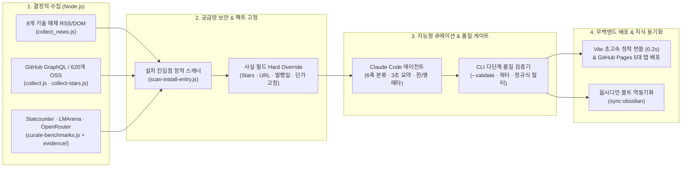
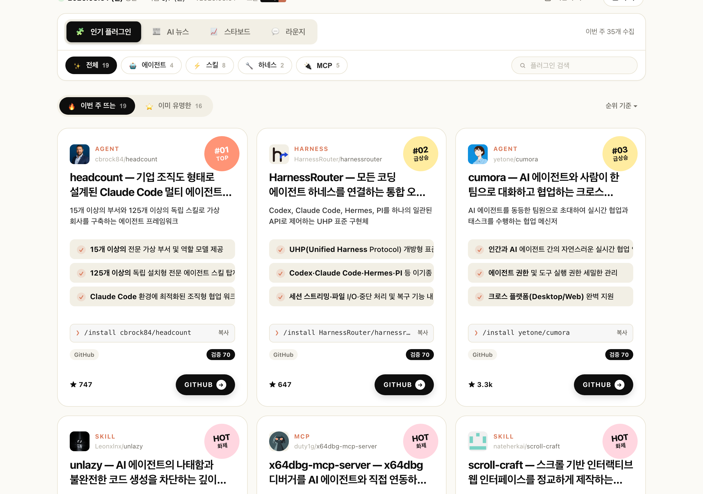
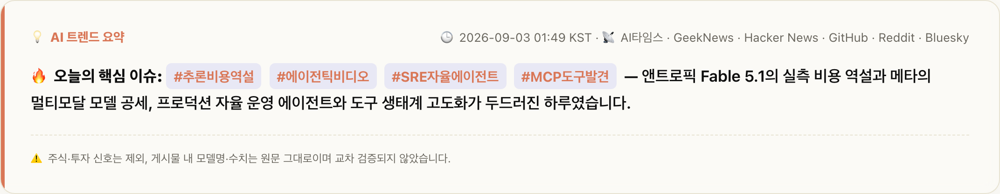
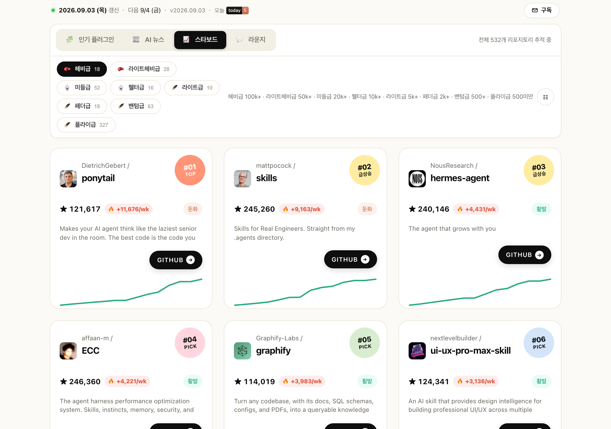
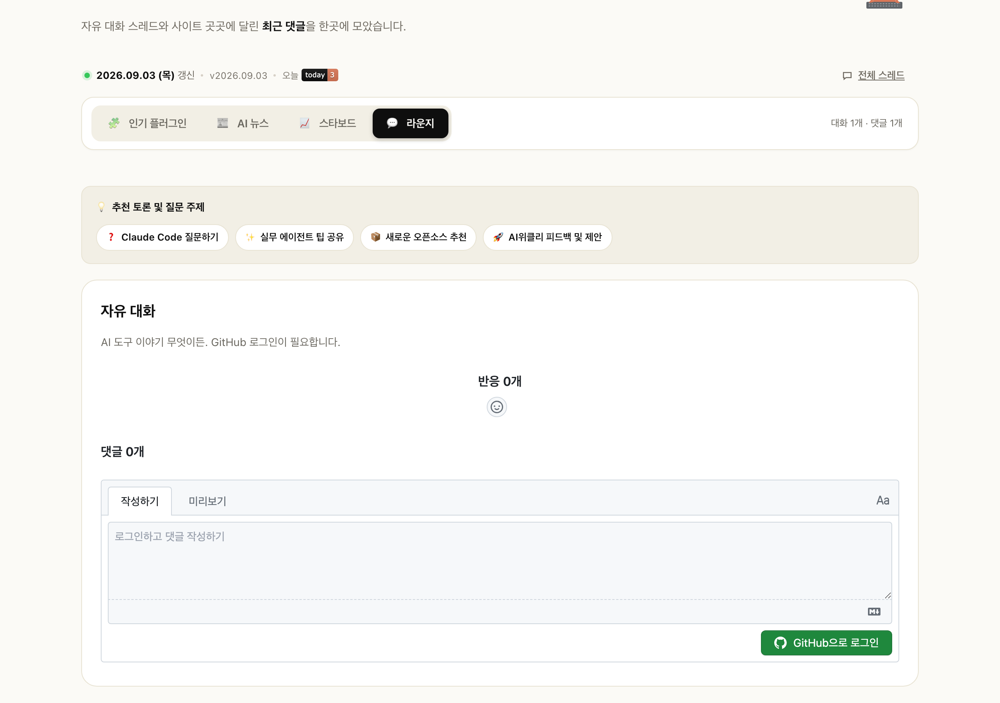

<div align="center">

# AI위클리 <sub>· AI Weekly</sub>

**최신 AI 기술 신호, Claude Code 에이전트 생태계, 프론티어 LLM 점유율·성능을 한눈에 조망하는 자율 데이터 파이프라인**

매일 정제되는 **AI 뉴스(3초 스캐닝 3대 포인트 & 접이식 심층 해설)**, 매주 분석되는 **인기 플러그인(Rising/Classic)**, **620개 오픈소스 3체급 스타보드(Starboard)**, 개발자 커뮤니티 **라운지(Lounge)**, 그리고 객관적 증빙 기반의 **AI 점유율·성능(Benchmarks)** 리더보드를 무백엔드 전자동 파이프라인으로 제공합니다.

[🌐 라이브 사이트 (홈)](https://ldk-hub.github.io/ai-weekly/) ·
[📊 점유율·성능 (NEW)](https://ldk-hub.github.io/ai-weekly/benchmarks) ·
[📰 AI 뉴스](https://ldk-hub.github.io/ai-weekly/news) ·
[📈 스타보드](https://ldk-hub.github.io/ai-weekly/starboard) ·
[💬 라운지](https://ldk-hub.github.io/ai-weekly/lounge) ·
[📡 주간 RSS](https://ldk-hub.github.io/ai-weekly/feed.xml) ·
[📰 뉴스 RSS](https://ldk-hub.github.io/ai-weekly/news-feed.xml)


</div>

---

## 💡 핵심 엔지니어링 아키텍처 & 신뢰성 설계 (Engineering Highlights)

> **"비결정적(Non-Deterministic) LLM 추론과 결정적(Deterministic) 수집·검증 파이프라인을 엄격히 분리하여, 환각 0%와 공급망 보안을 보장합니다."**



| 설계 영역 | 문제 정의 (Problem) | 아키텍처 해법 (Engineering Solution) | 검증 및 운영 효과 (Impact) |
| :--- | :--- | :--- | :--- |
| **🛡️ 환각 0% 격리**<br>*(Hard Override)* | LLM에 수집과 요약을 동시에 맡기면 가짜 URL, 왜곡된 스타 수, 잘못된 날짜가 섞이는 환각 발생 | I/O 수집·정규화는 Node.js 결정적 스크립트로 고정하고, **사실 메타데이터(Stars, URL, 발행일, 작성자)는 크롤러 원본으로 강제 덮어쓰기** 후 분류·요약만 에이전트에 위임 | 메타데이터 및 링크 환각 **0건** 달성 |
| **🔒 공급망 악성 코드 차단**<br>*(Static Security Scan)* | 급상승 오픈소스 중 `setup.py`·`install.sh`에 공인 IP를 하드코딩해 원격 코드를 `exec`/`eval`하는 드로퍼 위험 | 설치 진입점 파일을 정적 검사하는 **`scan-install-entry.js`**를 파이프라인에 내장하여 비인가 원격 실행 패턴 자동 격리 | 큐레이션 대상 중 **실제 악성 패키지 2건 사전 탐지·차단** |
| **✅ 다단계 품질 게이트**<br>*(Automated Validation)* | 요약 포맷 깨짐, 원문 단순 복붙, 주식/광고성 노이즈 기사 유입 및 특정 매체 편향 위험 | 배포 전 **`--validate` CLI 검증기**로 3대 포인트 불릿 규격, 5~10문장 해설 완결성, 금융/광고 정규식 필터(`FINANCE_RE`), 매체별 쿼터 균형을 전수 검사 (위반 시 배포 즉시 중단) | 수동 개입 없는 **일관된 프로덕션 품질 유지** |
| **📈 3체급 코호트 정규화**<br>*(League & Velocity)* | 단일 스타 수 순위표에서는 수만 스타의 거대 리포지토리에 가려 신생 유망 도구가 묻히는 왜곡 발생 | **620개** 추적 리포를 **헤비급(`10k+`) · 미들급(`1k~10k`) · 라이트급(`<1k`)** 3체급 리그로 분리하고, 주간 성장 속도(Velocity)와 커뮤니티 버즈를 결합한 4축 스코어링 적용 | 체급별 급성장 오픈소스 조기 발굴 및 시계열 원장 보존 |
| **📊 증빙 기반 벤치마크 & 초경량 운영**<br>*(Evidence-Backed Static)* | 모델 성능·점유율 비교 시 출처 불분명 및 백엔드 서버/DB 운영 비용 부담 | Statcounter·LMArena·OpenRouter 수집 시점의 **원본 스냅샷(`evidence/`)을 함께 보존**하고, 순수 JSON + **Vite 정적 빌드(0.2초 미만)**로 서버 비용 없이 무중단 운영 | **100% 출처 검증 가능**한 지표 제공 & 인프라 유지비 **\$0** |

---

## 🖥️ 라이브 서비스 5대 페이지 구성 ([ldk-hub.github.io/ai-weekly/](https://ldk-hub.github.io/ai-weekly/))

> 상단 메인 내비게이션은 핵심 데이터 탐색 빈도가 높은 **4대 탭(`인기 플러그인 · AI 뉴스 · 스타보드 · 점유율/성능`)**으로 집중 배치하고, 커뮤니티 공간인 **`라운지`**는 전 페이지 하단 푸터(`site-footer`) 및 직접 URL로 연결하여 모바일(375px) 뷰포트에서도 가로 넘침 없이 쾌적하게 탐색할 수 있도록 설계했습니다.

### 1. 🧩 인기 플러그인 (Popular Plugins · `index.html`)
매주 월요일, Claude Code 생태계(스킬 · MCP · 에이전트 · 하네스)에서 급부상하는 **🔥 이번 주 뜨는(Rising 20선)** 도구와 검증된 **⭐ 이미 유명한(Classic)** 레퍼런스를 인덱싱합니다.



- **직관적인 3종 순위 스티커 (`#01`, `#02/#03`, `신상`) & `KR` 한국어 지원 칩**: 복잡한 라벨을 제거하고 데이터 순위 기반 스티커와 한국어 지원(`KR`) 배지로 핵심 정보를 즉시 식별합니다.
- **원형 체크 불릿(`✓`) 3대 핵심 기능 & 원클릭 미니 CLI 설치 칩(`❯ /install ...`)**: 도구의 3대 특장점을 한눈에 읽고, 카드 하단 터미널 칩 클릭 한 번으로 설치 명령어를 복사해 즉시 적용할 수 있습니다.
- **카테고리 & 로컬 북마크(`⭐ 저장`) 필터**: `전체 · 스킬 · MCP · 에이전트 · 하네스` 필터와 함께 내가 찜한 플러그인만 모아보는 `⭐ 저장` 탭을 제공합니다.

---

### 2. 📰 AI 뉴스 (AI News · `news.html`)
**8개 지정 매체**(GeekNews, Hacker News, AI타임스, Reddit, GitHub, Bluesky, X, HF Daily Papers)에서 최근 24시간 내 발생한 진짜 기술 신호만을 선별해 제공합니다.



- **3초 스캐닝 3대 포인트 넘버 배지(`1`, `2`, `3`)**: 각 카드 상단에 핵심 키워드 볼드와 주황색 넘버 배지를 배치하여 3초 만에 이슈의 골자를 파악할 수 있습니다.
- **네이티브 접이식 아코디언(`<details>`) 심층 해설**: 5~10문장의 기술 배경 해설은 기본 접힘 상태로 제공하여 모바일 스크롤 피로도를 대폭 낮췄습니다.
- **기술 신호 6축 필터 & 뷰 모드 전환(`☷`)**: `모델 출시(model) · 제품 기능(product) · 개발자 도구(devtool) · 개인 오픈소스(oss) · 연구/논문(research) · 실무 활용(practice)` 6축 필터, `⭐ 저장` 북마크 모아보기, 그리드/리스트 뷰 전환을 지원합니다.

---

### 3. 📈 스타보드 (Starboard · `starboard.html`)
생태계 내 **620개 핵심 오픈소스**의 일간/주간 스타(Star) 증감 현황과 성장 모멘텀을 시계열 원장(`stars_ledger.json`) 기반으로 시각화합니다.



- **3대 체급 리그 분류 & 50개 단위 점진적 렌더링**: 스타 규모에 따라 **🥊 헤비급(`10,000★ 이상`) · 🥋 미들급(`1,000★ ~ 10,000★`) · 🪶 라이트급(`1,000★ 미만`)**으로 체급을 나누어 공정하게 성장 속도를 비교하며, 초기 50개 렌더링 후 50개 단위 `더 보기` 페이지네이션과 원장 캐싱으로 DOM 렌더링 부하를 최소화했습니다.
- **한국어 핵심 설명 박스(`desc_ko`) & 스파크라인 접근성**: 영문 리포지토리 설명에 앞서 한국어 한 줄 요약 박스를 최상단에 노출하고, 주간 스타 유입량(`+N/w`)·배지 범례·스파크라인 대체 텍스트(a11y)를 함께 제공합니다.

---

### 4. 💬 라운지 (Lounge · `lounge.html`)
방문한 개발자들이 Claude Code 활용 팁, MCP 도구 추천, 프롬프트 기법을 자유롭게 나누는 무백엔드 커뮤니티 공간입니다.



- **자유 대화 스레드 & 사이트 전체 최근 댓글 통합 뷰**: `collect_lounge.js`가 수집한 GitHub Discussions 스냅샷(`lounge_latest.json`)과 Giscus를 연동해 별도 회원가입이나 DB 없이 GitHub 계정으로 즉시 소통합니다.
- **4대 온보딩 토픽 가이드 칩**: `❓ Claude Code 질문하기 · ✨ 실무 에이전트 팁 공유 · 📦 신규 MCP 도구 추천 · 🚀 AI위클리 기능 피드백` 가이드로 첫 대화를 쉽게 시작할 수 있습니다.

---

### 5. 📊 점유율·성능 (Benchmarks · `benchmarks.html` — `NEW`)
글로벌 AI 서비스의 웹 리퍼럴 트래픽 점유율과 프론티어 LLM의 코딩·선호도·가성비 지표를 원본 증빙(`evidence/`)과 함께 추적하는 리더보드입니다.

- **상단 4대 핵심 요약 칩 (원클릭 정렬 연동)**:
  - **`리퍼럴 1위`** (Statcounter 월간 웹 방문 리퍼럴 점유율 1위 및 전월 대비 증감 `%p`)
  - **`코딩 최고점`** (LMArena Coding 리더보드 최고 Elo 모델)
  - **`선호도 최고점`** (LMArena Overall 종합 선호도 최고 Elo 모델)
  - **`가성비 1위`** (코딩 점수 상위 절반 모델 중 OpenRouter 입출력 가중 단가 최저가 모델)
- **점유율 / 성능 듀얼 뷰 & 다중 정렬**: `점유율`(Statcounter 월간 바 차트 및 기타 모델 펼치기) 탭과 `성능`(회사별 대표 프론티어 모델의 `코딩 · 선호도 · 입출력 가격($/1M) · 컨텍스트 윈도우` 비교 및 `코딩 / 선호도 / 가격 낮은 순` 정렬) 탭을 제공하며, 상단에 모든 데이터의 출처와 기준일을 투명하게 명시합니다.

---

### 🌐 전역 사용자 경험 & 웹 접근성 (Global UX & Accessibility)
- **한/영 실시간 전환 (`EN / KO`) & 다크/라이트 테마 (`🌙 다크`)**: 상단 토글로 전 페이지 UI 라벨을 한국어/영어로 즉시 전환하며, 라이트/다크 모드 전 구간에서 **WCAG 4.5:1 이상 명도대비(`--accent-text`, `--mint` 토큰)**를 보장합니다.
- **웹 접근성(a11y) 및 모바일 뷰포트 최적화**: 전 페이지 본문 건너뛰기(`skip-link`), 상세 모달 오픈 시 포커스 트랩(Focus Trap) 및 `Esc` 닫기 시 트리거 버튼 포커스 복귀, 375px 모바일 화면 가로 스크롤 0건 수납, 외부 웹폰트 요청 제거를 적용했습니다.
- **로컬 북마크 (`⭐ 저장`) & 즉시 검색 (`/`)**: 별도 로그인 없이 관심 있는 뉴스·플러그인을 브라우저에 저장해 모아볼 수 있으며, 단축키 `/`로 즉시 검색창에 포커스합니다.
- **지난 주차/뉴스 아카이브 & 이메일 구독**: 과거 발행된 모든 주간 인덱스·일간 뉴스 스냅샷을 타임머신 드롭다운으로 탐색하고 Substack 뉴스레터를 구독할 수 있습니다.

---

## 🚀 디렉토리 구조 및 실행 방법

### 📂 디렉토리 구조
```text
ai-weekly/
├── .agents/skills/          # 자동화 스킬 정의 (cc-news, cc-star, cc-daily, cc-weekly, ai-weekly-vault)
├── .github/workflows/       # GitHub Actions 무인 스케줄러 (deploy-pages.yml, stars.yml, weekly-trends.yml)
├── docs/                    # 아키텍처 설계 문서, 벤치마크 검증 리포트 및 스크린샷 자산 (docs/images/)
├── site/                    # Vite 기반 멀티페이지 정적 웹 프론트엔드
│   ├── index.html           # 🧩 인기 플러그인 (홈)
│   ├── news.html            # 📰 AI 뉴스
│   ├── starboard.html       # 📈 스타보드 (620개 OSS 3체급 리그)
│   ├── lounge.html          # 💬 라운지 (커뮤니티)
│   ├── benchmarks.html      # 📊 점유율·성능 (AI 리퍼럴 점유율 & 프론티어 LLM 리더보드)
│   ├── styles.css           # 디자인 토큰 및 반응형 다크/라이트 스타일시트
│   ├── src/                 # 상태 관리(state.js) 및 탭별 렌더링 엔진(main.js)
│   └── public/data/         # 라이브 JSON 데이터 (latest, news_latest, stars_meta/ledger, lounge_latest, benchmarks_latest)
├── scripts/
│   ├── news/                # 8개 매체 뉴스 수집(collect_news.js) 및 큐레이션·검증(curate_news.js --validate)
│   ├── plugins/             # 트렌드 수집(collect.js), 진입점 보안 스캔(scan-install-entry.js), 발행(publish-curated.js)
│   ├── stars/               # 620개 리포 스타 크롤러(collect-stars.js) 및 시계열 원장 빌더(build-stars-ledger.js)
│   ├── benchmarks/          # 점유율·벤치마크 정제기(curate-benchmarks.js)
│   ├── community/           # GitHub Discussions 라운지 스냅샷 수집기(collect_lounge.js)
│   └── core/                # RSS 피드, OG 이미지, 아카이브 인덱스 생성기 및 옵시디언 역동기화(obsidian_export.js)
└── data/                    # 주차별/일자별 아카이브, 스타 시계열 원장 및 벤치마크 원본 증빙(evidence/)
```

### 💻 실행 명령어 (NPM Scripts)

```bash
# 1. 로컬 개발 서버 및 프로덕션 빌드
npm run dev              # Vite 로컬 개발 서버 실행 (http://localhost:5173)
npm run build            # 프로덕션 정적 번들 빌드 (dist/)
npm run preview          # 빌드된 프로덕션 번들 로컬 프리뷰

# 2. 탭별 데이터 파이프라인 및 보안·품질 검증
npm run data:news        # 📰 8개 매체 AI 뉴스 수집 및 큐레이션
node scripts/news/curate_news.js --validate   # 뉴스 품질 게이트 단독 검증
npm run data:stars       # 📈 스타보드 620개 오픈소스 스타 증감 갱신
npm run data:plugins     # 🧩 주간 플러그인 수집 ➔ 진입점 보안 스캔 ➔ 큐레이션 일괄 실행
npm run data:scan        # 🔒 오픈소스 설치 진입점 악성 드로퍼 정적 스캔 단독 실행
npm run data:publish     # 🚀 큐레이션 완료된 주간 플러그인 데이터 배포 반영
npm run data:benchmarks  # 📊 AI 점유율 및 프론티어 모델 성능 벤치마크 데이터 갱신
npm run data:lounge      # 💬 GitHub Discussions 라운지 스냅샷 갱신
npm run sync:obsidian    # 📝 로컬 옵시디언 볼트(Second Brain) 마크다운 역동기화
```

---

## 📄 라이선스 및 아키텍트 안내

- **코드 라이선스**: [MIT License](LICENSE) · **데이터 라이선스**: [CC-BY 4.0](https://creativecommons.org/licenses/by/4.0/)
- 버그 제보 및 오픈소스 등재 제안은 [GitHub Issues](https://github.com/ldk-hub/ai-weekly/issues) 또는 [AI 라운지](https://ldk-hub.github.io/ai-weekly/lounge)를 통해 환영합니다.

<div align="center">
Maintained by <strong><a href="https://github.com/ldk-hub">이동옥 (ldk-hub)</a></strong> · <a href="https://ldk-hub.github.io/about/">Developer About</a> · <a href="https://ldk-hub.github.io/portfolio/">Technical Portfolio</a><br>
Forked &amp; Evolved from <a href="https://github.com/INNO-HI/weeklaude">weeklaude</a> by INNO-HI (MIT)
</div>
